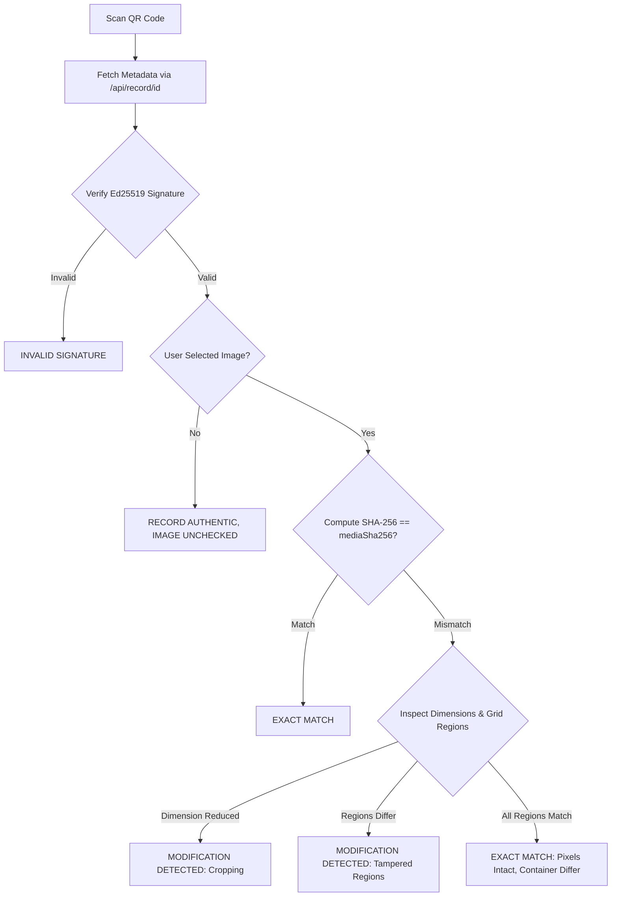

# GeoCam Privacy-First Architecture & Tampering Detection

## 1. Executive Summary

GeoCam Privacy-First Edition transforms GeoCam from a centralized media-storage service into a zero-knowledge photo authenticity verification architecture.

### Core Principles
1. **Zero Media Upload**: Original photographs and videos never leave the user's device. The backend verification server never receives, processes, or stores any media bytes.
2. **Dual-Layer Authenticity Proof**:
   - **Layer A (Exact-File Digest)**: SHA-256 over exact authenticated media bytes ensures byte-for-byte perfection.
   - **Layer B (Region Fingerprint Grid)**: Authenticated 8×8 grid of region SHA-256 digests (`grid-sha256-v1`) enables localized tampering and cropping detection without revealing actual pixels.
3. **Local-Only Verification**: All photo inspections happen entirely on the recipient's device inside the GeoCam app. Recipient photos are never uploaded to any server.
4. **Public Verification Hygiene**: The public web verification page (`https://<server>/<id>`) confirms digital signature validity and metadata, but never displays or links to original media, prompting recipients to verify their actual file locally with GeoCam.

---

## 2. Threat Model & Privacy Guarantees

| Attack Vector | Threat Scenario | Mitigation in GeoCam Privacy-First |
|---|---|---|
| **Server Compromise / Subpoena** | Attacker accesses backend database or object storage to exfiltrate photos. | **Impossible**. The server stores zero media bytes, zero thumbnails, and zero reversible representations. Only non-reversible SHA-256 digests and cryptographic signatures exist on the server. |
| **Public Scraping** | Web crawlers scan QR codes to scrape private photos. | The public webpage contains no `` tags, no media download links, and `/media` returns HTTP `410 Gone`. |
| **Localized Tampering (Splice / Stamp Removal)** | Attacker alters a portion of the photo (e.g. erasing stamp or editing faces/numbers). | Layer A flags SHA-256 mismatch. Layer B pinpoints the exact modified cells in the 8×8 grid (e.g. "4 of 64 regions modified"). |
| **Photo Cropping** | Attacker crops the photo while keeping the QR code intact to fake authenticity. | Layer B checks dimension reduction (`imageWidth` × `imageHeight`) and flags cropping immediately. |
| **Record Collision / ID Hijacking** | Attacker registers an existing record ID with forged content. | Server enforces cryptographic idempotency: identical records return `200 alreadyExists`, but duplicate IDs with differing crypto fields are rejected with `409 Conflict`. |
| **Stale / Replayed Signature** | Attacker mutates metadata or region fingerprints. | Ed25519 signature covers all fields including `img` and `fp_sha256`. Mutating any field breaks the signature. |

---

## 3. Signed Manifest Specification (v3)

The canonical string signed by the device's private Ed25519 key follows a deterministic, pipe-delimited format:

```text
v=3|id=<id>|type=<type>|ts=<iso8601>|lat=<6dp>|lng=<6dp>|acc=<1dp>|alt=<1dp>|addr64=<b64>|media_sha256=<hex>|img=<WxH>|fp_version=<int>|fp_sha256=<hex>
```

### Field Definitions:
- `v=3`: Protocol version identifier.
- `id`: Unique record ID (e.g. `GC-20261018-7F3A9C12`).
- `type`: `photo` or `video`.
- `ts`: ISO 8601 UTC timestamp (e.g. `2026-10-18T01:45:00.000000Z`).
- `lat` / `lng`: Latitude / Longitude formatted to 6 decimal places (`null` if GPS unavailable).
- `acc` / `alt`: Accuracy / Altitude formatted to 1 decimal place (`null` if unavailable).
- `addr64`: Base64-encoded UTF-8 address string (preserves Unicode and punctuation safely).
- `media_sha256`: Hex-encoded SHA-256 digest of the finalized, stamped media file.
- `img`: Original image dimensions formatted as `<width>x<height>` (e.g. `3024x4032`).
- `fp_version`: Fingerprint algorithm version (`1` for `grid-sha256-v1`, `0` for none).
- `fp_sha256`: SHA-256 hex digest of the canonical JSON string of the region manifest.

### Backward Compatibility (v2)
Legacy v2 records lack `img`, `fp_version`, and `fp_sha256`. The server and client verify v2 records using the exact legacy canonical format without breaking historical signatures.

---

## 4. Region Fingerprint Grid (`grid-sha256-v1`)

### Generation (Sender)
1. The finalized stamped JPEG bytes are decoded into raw pixel data.
2. The image canvas is partitioned into an $R \times C$ grid (default: $8 \times 8 = 64$ cells).
3. For each cell $(r, c)$:
   $$\begin{aligned}
   x_0 &= \lfloor (c \cdot W) / C \rfloor, & x_1 &= \lfloor ((c + 1) \cdot W) / C \rfloor \\
   y_0 &= \lfloor (r \cdot H) / R \rfloor, & y_1 &= \lfloor ((r + 1) \cdot H) / R \rfloor
   \end{aligned}$$
4. Raw RGB/RGBA pixel bytes within $[x_0, x_1) \times [y_0, y_1)$ are extracted.
5. Each cell's bytes are hashed with SHA-256 to produce a 64-character hex digest.
6. The manifest is serialized into deterministic canonical JSON with sorted keys:
   ```json
   {"algorithm":"grid-sha256-v1","fpVersion":1,"gridCols":8,"gridRows":8,"imageHeight":4032,"imageWidth":3024,"regions":["a1b2...","c3d4...",...]}
   ```
7. `fp_sha256 = sha256(canonical_json)` is bound into the Ed25519 signature.

---

## 5. Local On-Device Verification (Recipient)



### Verification Outcomes Matrix

| Result State | Signature | File SHA-256 | Image Provided | Regions Matching | Meaning |
|---|---|---|---|---|---|
| **EXACT MATCH** | Valid | Matches | Yes | 100% | The received file is identical byte-for-byte to the registered original. |
| **MODIFICATION DETECTED** | Valid | Mismatches | Yes | $< 100\%$ or Dim Mismatch | Authenticated evidence proves the photo was cropped, edited, or altered. |
| **RECORD AUTHENTIC, IMAGE UNCHECKED** | Valid | — | No | — | The record metadata and signature are authentic, but no photo has been supplied for inspection. |
| **INVALID SIGNATURE** | Invalid | Any | Any | Any | Signature verification failed. Record cannot be trusted. |
| **UNABLE TO VERIFY** | Any | Any | Any | Malformed | Record missing, format corrupted, or image unreadable. |

---

## 6. Limitations of Cropping Detection

- **Loss of Surrounding Context**: If an attacker crops a photo tightly around a subject, the cropped file contains fewer pixels than the original. Layer B identifies that `imageWidth` or `imageHeight` was reduced and flags **MODIFICATION DETECTED (Cropping)**.
- **Resampling vs. Pure Crop**: If a cropped image has also been rescaled (interpolated) back to the original resolution, grid cell pixel boundaries shift and all region hashes mismatch. The system correctly flags **MODIFICATION DETECTED**.
- **Social Media Transcoding**: Messaging apps (e.g. WhatsApp, Telegram) recompress images and strip metadata. This changes the whole-file SHA-256 (Layer A mismatch). If compression artifacts alter pixel values significantly, individual region hashes will differ. GeoCam correctly informs the user that the file has undergone modification.

---

## 7. Storage Footprint Analysis

| Component | Legacy Storage (per 1,000 photos) | Privacy-First Storage (per 1,000 photos) | Reduction |
|---|---|---|---|
| **Raw Stored Media** | ~3.5 GB to 5.0 GB | **0 Bytes** | **100%** |
| **Database Metadata** | ~0.5 MB | ~3.2 MB (includes 64 region hashes) | — |
| **Total Server Storage** | **~4,000 MB** | **~3.2 MB** | **> 99.9%** |

Serialized manifest size for an $8 \times 8$ grid:
- 64 hex hashes × 64 chars = 4,096 bytes
- JSON envelope: ~150 bytes
- Total per record: **~4.2 KB** (negligible).

## Configuration & known limits (added in hardening pass)
- `GEOCAM_ENABLE_LEGACY_SYNC=1` re-enables the old media-accepting `/sync` (bytes are hash-checked then discarded). Off by default (410).
- `GEOCAM_TRUSTED_PUBLIC_KEYS` (comma-separated) restricts which device keys may register. **If unset, any key that signs its own record is accepted** — a valid signature then proves only that the record is unaltered, not that a genuine GeoCam device made it.
- `GEOCAM_APP_URL` sets the "Get GeoCam" link on the public page (hidden if unset). `GEOCAM_RATE_LIMIT_PER_MIN` (default 60, per IP, in-memory, per process) covers `/register` and `/api/*`.
- `/api/record/<id>` returns the signed capture fields **including location**, because the app verifies the Ed25519 signature itself instead of trusting the server. The public HTML page never shows location. A location-free signature format (v4) would remove this exposure.
- The app trusts region fingerprints only if they hash to the signed `fpSha256`. The grid check is pixel-exact: resized, rotated or recompressed copies are reported as modified, not aligned or matched. "Pixels match but file differs" is reported as MODIFICATION DETECTED (not EXACT MATCH).
- The scanner uses the system file picker (`file_picker`); the chosen photo is read locally and never uploaded.
