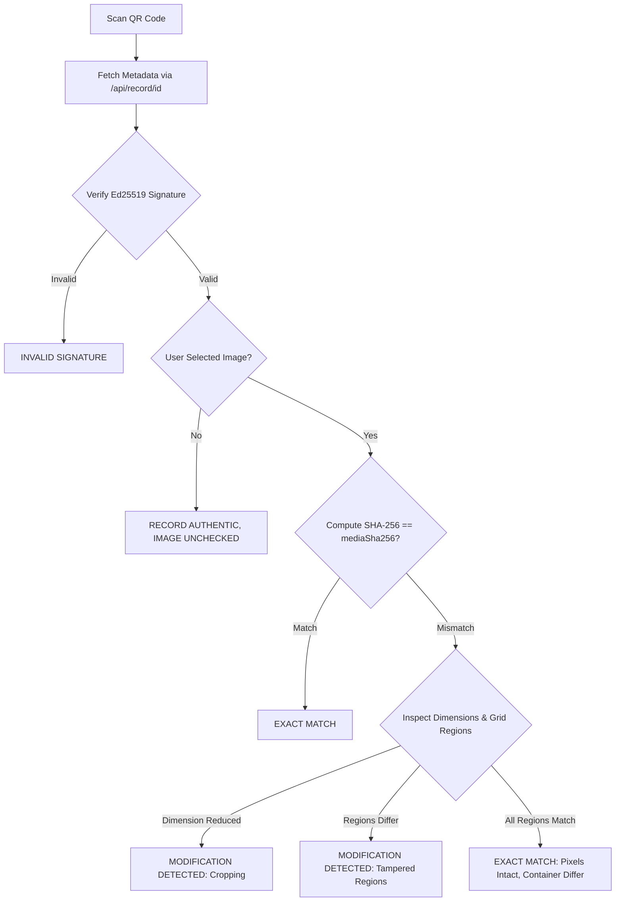

# GeoCam Privacy-First Architecture & Tampering Detection

## 1. Executive Summary

GeoCam Privacy-First Edition transforms GeoCam from a centralized media-storage service into a zero-knowledge photo authenticity verification architecture.

### Core Principles
1. **Zero Media Upload**: Original photographs and videos never leave the user's device. The backend verification server never receives, processes, or stores any media bytes.
2. **Dual-Layer Authenticity Proof**:
   - **Layer A (Exact-File Digest)**: SHA-256 over exact authenticated media bytes ensures byte-for-byte perfection.
   - **Layer B (Region Fingerprint Grid)**: Signed 8×8 grid of tolerant luma tiles (`grid-luma-v2`; legacy `grid-sha256-v1` still verifies) flags edited regions and grid-aligned crops, and treats resized/recompressed copies as consistent-but-not-exact.
3. **Local-Only Verification**: All photo inspections happen entirely on the recipient's device inside the GeoCam app. Recipient photos are never uploaded to any server.
4. **Public Verification Hygiene**: The public web verification page (`https://<server>/<id>`) confirms digital signature validity and metadata, but never displays or links to original media, prompting recipients to verify their actual file locally with GeoCam.

---

## 2. Threat Model & Privacy Guarantees

| Attack Vector | Threat Scenario | Mitigation in GeoCam Privacy-First |
|---|---|---|
| **Server Compromise / Subpoena** | Attacker accesses backend database or object storage to exfiltrate photos. | **Impossible**. The server stores zero media bytes, zero thumbnails, and zero reversible representations. Only non-reversible SHA-256 digests and cryptographic signatures exist on the server. |
| **Public Scraping** | Web crawlers scan QR codes to scrape private photos. | The public webpage contains no `` tags, no media download links, and `/media` returns HTTP `410 Gone`. |
| **Localized Tampering (Splice / Stamp Removal)** | Attacker alters a portion of the photo (e.g. erasing stamp or editing faces/numbers). | Layer A flags SHA-256 mismatch. Layer B pinpoints the exact modified cells in the 8×8 grid (e.g. "4 of 64 regions modified"). |
| **Photo Cropping** | Attacker crops the photo while keeping the QR code intact to fake authenticity. | Layer B checks dimension reduction (`imageWidth` × `imageHeight`) and flags cropping immediately. |
| **Record Collision / ID Hijacking** | Attacker registers an existing record ID with forged content. | Server enforces cryptographic idempotency: identical records return `200 alreadyExists`, but duplicate IDs with differing crypto fields are rejected with `409 Conflict`. |
| **Stale / Replayed Signature** | Attacker mutates metadata or region fingerprints. | Ed25519 signature covers all fields including `img` and `fp_sha256`. Mutating any field breaks the signature. |

---

## 3. Signed Manifest Specification (v3)

The canonical string signed by the device's private Ed25519 key follows a deterministic, pipe-delimited format:

```text
v=3|id=<id>|type=<type>|ts=<iso8601>|lat=<6dp>|lng=<6dp>|acc=<1dp>|alt=<1dp>|addr64=<b64>|media_sha256=<hex>|img=<WxH>|fp_version=<int>|fp_sha256=<hex>
```

### Field Definitions:
- `v=3`: Protocol version identifier.
- `id`: Unique record ID (e.g. `GC-20261018-7F3A9C12`).
- `type`: `photo` or `video`.
- `ts`: ISO 8601 UTC timestamp (e.g. `2026-10-18T01:45:00.000000Z`).
- `lat` / `lng`: Latitude / Longitude formatted to 6 decimal places (`null` if GPS unavailable).
- `acc` / `alt`: Accuracy / Altitude formatted to 1 decimal place (`null` if unavailable).
- `addr64`: Base64-encoded UTF-8 address string (preserves Unicode and punctuation safely).
- `media_sha256`: Hex-encoded SHA-256 digest of the finalized, stamped media file.
- `img`: Original image dimensions formatted as `<width>x<height>` (e.g. `3024x4032`).
- `fp_version`: Fingerprint algorithm version (`2` for `grid-luma-v2`, `1` for `grid-sha256-v1`, `0` for none).
- `fp_sha256`: SHA-256 hex digest of the canonical JSON string of the region manifest.

### Backward Compatibility (v2)
Legacy v2 records lack `img`, `fp_version`, and `fp_sha256`. The server and client verify v2 records using the exact legacy canonical format without breaking historical signatures.

---

## 4. Region Fingerprint Grid (`grid-sha256-v1`)

### Generation (Sender)
1. The finalized stamped JPEG bytes are decoded into raw pixel data.
2. The image canvas is partitioned into an $R \times C$ grid (default: $8 \times 8 = 64$ cells).
3. For each cell $(r, c)$:
   $$\begin{aligned}
   x_0 &= \lfloor (c \cdot W) / C \rfloor, & x_1 &= \lfloor ((c + 1) \cdot W) / C \rfloor \\
   y_0 &= \lfloor (r \cdot H) / R \rfloor, & y_1 &= \lfloor ((r + 1) \cdot H) / R \rfloor
   \end{aligned}$$
4. Raw RGB/RGBA pixel bytes within $[x_0, x_1) \times [y_0, y_1)$ are extracted.
5. Each cell's bytes are hashed with SHA-256 to produce a 64-character hex digest.
6. The manifest is serialized into deterministic canonical JSON with sorted keys:
   ```json
   {"algorithm":"grid-sha256-v1","fpVersion":1,"gridCols":8,"gridRows":8,"imageHeight":4032,"imageWidth":3024,"regions":["a1b2...","c3d4...",...]}
   ```
7. `fp_sha256 = sha256(canonical_json)` is bound into the Ed25519 signature.

---

## 5. Local On-Device Verification (Recipient)



### Verification Outcomes Matrix

| Result State | Signature | File SHA-256 | Image Provided | Regions Matching | Meaning |
|---|---|---|---|---|---|
| **EXACT MATCH** | Valid | Matches | Yes | 100% | The received file is identical byte-for-byte to the registered original. |
| **MODIFICATION DETECTED** | Valid | Mismatches | Yes | $< 100\%$ or Dim Mismatch | Authenticated evidence proves the photo was cropped, edited, or altered. |
| **RECORD AUTHENTIC, IMAGE UNCHECKED** | Valid | — | No | — | The record metadata and signature are authentic, but no photo has been supplied for inspection. |
| **INVALID SIGNATURE** | Invalid | Any | Any | Any | Signature verification failed. Record cannot be trusted. |
| **UNABLE TO VERIFY** | Any | Any | Any | Malformed | Record missing, format corrupted, or image unreadable. |

---

## 6. Limitations of Cropping Detection

- **Loss of Surrounding Context**: If an attacker crops a photo tightly around a subject, the cropped file contains fewer pixels than the original. Layer B identifies that `imageWidth` or `imageHeight` was reduced and flags **MODIFICATION DETECTED (Cropping)**.
- **Resampling vs. Pure Crop**: If a cropped image has also been rescaled (interpolated) back to the original resolution, grid cell pixel boundaries shift and all region hashes mismatch. The system correctly flags **MODIFICATION DETECTED**.
- **Social Media Transcoding**: Messaging apps (e.g. WhatsApp, Telegram) recompress images and strip metadata. This changes the whole-file SHA-256 (Layer A mismatch). If compression artifacts alter pixel values significantly, individual region hashes will differ. GeoCam correctly informs the user that the file has undergone modification.

---

## 7. Storage Footprint Analysis

| Component | Legacy Storage (per 1,000 photos) | Privacy-First Storage (per 1,000 photos) | Reduction |
|---|---|---|---|
| **Raw Stored Media** | ~3.5 GB to 5.0 GB | **0 Bytes** | **100%** |
| **Database Metadata** | ~0.5 MB | ~3.2 MB (includes 64 region hashes) | — |
| **Total Server Storage** | **~4,000 MB** | **~3.2 MB** | **> 99.9%** |

Serialized manifest size for an $8 \times 8$ grid:
- 64 hex hashes × 64 chars = 4,096 bytes
- JSON envelope: ~150 bytes
- Total per record: **~4.2 KB** (negligible).

## Configuration & known limits (added in hardening pass)
- `GEOCAM_ENABLE_LEGACY_SYNC=1` re-enables the old media-accepting `/sync` (bytes are hash-checked then discarded). Off by default (410).
- `GEOCAM_TRUSTED_PUBLIC_KEYS` (comma-separated) restricts which device keys may register. **If unset, any key that signs its own record is accepted** — a valid signature then proves only that the record is unaltered, not that a genuine GeoCam device made it.
- `GEOCAM_APP_URL` sets the "Get GeoCam" link on the public page (hidden if unset). `GEOCAM_RATE_LIMIT_PER_MIN` (default 60, per IP, in-memory, per process) covers `/register` and `/api/*`.
- `/api/record/<id>` returns the signed capture fields **including location**, because the app verifies the Ed25519 signature itself instead of trusting the server. The public HTML page never shows location. A location-free signature format (v4) would remove this exposure.
- The app trusts region fingerprints only if they hash to the signed `fpSha256`. The grid check is pixel-exact: resized, rotated or recompressed copies are reported as modified, not aligned or matched. "Pixels match but file differs" is reported as MODIFICATION DETECTED (not EXACT MATCH).
- The scanner uses the system file picker (`file_picker`); the chosen photo is read locally and never uploaded.

## Audit notes (signing, sync, GPS)
- The signed string starts with `v=<protocol version>` (2 or 3). The server previously hard-coded `v=2`, so real v3 photos could not register; a shared golden vector is now asserted in `tests/test_privacy_registration.py` and `test/sync_service_test.dart`.
- Fingerprints are hashes of the decoded pixel buffer (`image` package, no EXIF rotation), computed in a background isolate.
- `/register` rejects fingerprint manifests that are not valid JSON, larger than 64x64 grid, or whose region list does not match the grid.
- Rate limiting never uses `X-Forwarded-For` (see "Rate limiting and client IP" below).

## Tolerant fingerprint `grid-luma-v2` (fpVersion 2)
- The photo is converted to brightness, normalised to at most 1024 px on the long side, and cut into an 8x8 grid. Each tile is stored as 19 hex characters: a 64-bit pattern (which of its 8x8 sub-blocks are brighter than the tile average), the tile's average brightness (0-255) and a flat-tile flag.
- Tiles match when the average brightness differs by at most 16 and at most 12 of 64 pattern bits differ (flat tiles compare by brightness only).
- Same framing (aspect ratio within 1.5%): all tiles match -> `FILE CHANGED, CONTENT CONSISTENT` (not authentic/exact); otherwise `MODIFICATION DETECTED` with the differing tiles.
- Different framing: the app tries to locate a grid-aligned crop (at least 85% of tiles match, with at least 2 non-flat tiles). Crops that do not follow the grid are reported as different framing without a location. Rotation is not corrected.
- Same framing but most tiles differ (rotation, a different picture, heavy edits): reported as a mismatch without per-tile locations, because locations would be meaningless.
- Measured on synthetic 1280x960 images (smooth and multi-scale texture; not real photographs): JPEG recompression q15-q90 and downscaling to 16%-78% produced 0-3 flagged tiles in 8 trials per image type. Edits: 20x15 px patches were never flagged; 40x30 px only at extreme contrast; 80x60 px at most contrasts; 160x120 px at all tested contrasts. Dark-on-dark and other low-contrast edits are inherently harder because the tolerance (mean +-16, 12 pattern bits) is meant to absorb recompression noise. This is evidence, not proof.
- Grid size: the default is 8x8 and luma-v2 grids are limited to 16x16 on both the app and the server (v1: 64x64, in practice bounded by the 256 KB manifest limit). A 16x16 grid detects smaller edits but grows the manifest (about 1.5 KB at 8x8, 5.7 KB at 16x16) and raised false alarms on noisy textures. The limit exists because the crop search costs roughly (tiles)^2 x 64 per candidate size: about a million tile operations at 16x16, about 250 times more at 64x64.
- Edit locations are shown only when the tiles that match are closely aligned with the original (median differing pattern bits < 3 and 75th percentile < 7 across non-flat tiles, and at least 8 non-flat tiles). Otherwise the result says "Framing differs or content changed; specific regions cannot be reliably located." Measured on synthetic photos, shifted or zoomed copies (3%-10%) otherwise flagged 9 to 51 of 64 tiles that were not edits. The rule is presentation only; matching thresholds are unchanged. It is a heuristic tuned on synthetic images.
- The signed record's capture time is the phone's clock and is not independently verified; the server records its own registration time (`registeredAt`).

## What each check proves (summary)
- **Exact file hash (SHA-256)**: the received bytes are identical to the file that was signed. Strongest result; only this gives `EXACT MATCH`.
- **Approximate region fingerprint**: the received picture looks like the original at tile level after allowing for resizing and recompression, or it differs in specific tiles. `FILE CHANGED, CONTENT CONSISTENT` is never proof that the image is unedited or authentic.
- **Valid signature**: the record was signed with the key shown and has not changed since. It does not say who owns that key or that the scene is real; the server accepts self-signed keys unless `GEOCAM_TRUSTED_PUBLIC_KEYS` is set.
- **Formats**: `grid-sha256-v1` (pixel-exact digests, fpVersion 1) and `grid-luma-v2` (fpVersion 2). The server rejects any other algorithm.
- **Where it runs**: the received photo is hashed and fingerprinted on the recipient's phone and is never uploaded. The server exposes the signed metadata (including exact location fields, see above) and the fingerprint manifest, never media.

## Time fields
- `timestamp` (captured): the phone's clock, signed, not independently verified.
- `registeredAt`: set by the server when the record is first accepted (UTC ISO 8601 with `Z`). The phone cannot supply it, retries do not change it, and it only shows the record existed by then; a photo taken offline for days is registered days later. Records stored without a value show "Not recorded (older record)".
- `gpsClockOffsetMs` (optional, inside the signed fingerprint manifest, photos only): phone clock minus the time reported by a platform GPS fix just before capture (positive = phone ahead). It is a clock-consistency check, not proof of when the photo was taken. It is recorded whatever the fix accuracy; mocked fixes, fixes before 2020 or more than 366 days from the phone clock, and fixes whose timestamps do not advance in step with a monotonic clock (frozen, replayed, jumping; the first fix is never used alone) are ignored, and it is omitted if no live fix was seen in the previous 30 s. Slightly future-dated fixes are not rejected, because a phone clock running behind looks exactly like that. The result page flags differences over 2 minutes. Accuracy is about a second or two. The public page and API show the offset only when the stored manifest hashes exactly to the signed `fpSha256` (`manifestVerified`); otherwise they say it could not be verified. It is only as trustworthy as the GPS provider and the phone, and is absent for videos and for older photos. It is part of the hashed manifest, so it needs no new protocol version; builds that predate it ignore it.

## Rate limiting and client IP
- Limits: `GEOCAM_RATE_LIMIT_PER_MIN` (default 60) per client for `/register` and `/api/*`, in memory per process. A value <= 0 (or an unparsable one) is ignored and the default 60 applies, unless `GEOCAM_ENV=test`, which only `tests/conftest.py` sets.
- The client is the socket peer unless `GEOCAM_CLIENT_IP_HEADER` names a header that a trusted proxy sets and overwrites (it must contain exactly one valid IP, otherwise the peer is used). `X-Forwarded-For` is never used.
- Render: Render's own article says Cloudflare sets `CF-Connecting-IP` on public web services and overwrites caller values, and that `X-Forwarded-For` can be forged by its leftmost entries. That was not verified against this deployment. Until it is, leave the variable empty (render.yaml does). Per-client isolation is therefore NOT verified: behind a shared proxy every user probably shares one bucket, so the limit is effectively global. To verify safely, set it to `CF-Connecting-IP` on a test deployment and confirm that requests from two networks are counted separately and that a forged `CF-Connecting-IP` sent by a client is overwritten.
